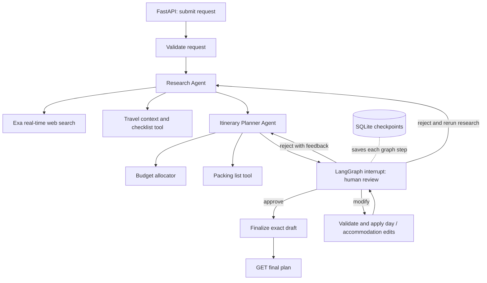

# AI Travel Planner

A local Express Analytics take-home solution: FastAPI accepts travel preferences, a LangGraph orchestrator coordinates research and itinerary planning, and a human reviews the draft before it becomes final. SQLite checkpoints preserve the request, research, draft, review history and interrupt across application restarts.

## Architecture



`workflow.py` is the orchestrator, implemented with `StateGraph`. Each agent is a separate node with a focused LLM prompt and two explicit tools. Tool calls are deterministic Python calls within the agent: research always searches, and planning always gets a budget and packing list. This keeps tool use predictable without an open-ended agent loop. Anthropic's forced `submit_result` tool returns structured output; Pydantic validates it.

| Agent | Tool | Purpose |
|---|---|---|
| Research | Exa search | Two live queries covering attractions/interests and safety/weather/seasonality; an additional query when revising research with feedback |
| Research | Travel context | Local checklist, inclusive trip dates, nights, retrieval timestamp and planning scope; explicitly not a weather forecast |
| Planner | Budget allocator | Group-level category targets and reserve in the requested currency |
| Planner | Packing list | Basic packing checklist with outdoor/beach additions based on interests |

Research retains source URLs and excerpts. Each activity must cite a retrieved URL. The planner validates every trip date, unique activity slots and total estimated cost; it makes at most one repair attempt for invalid output. Citation membership checks do not prove that a source supports every generated claim.

## Setup and run

Requirements: Python 3.11–3.14 (tested on 3.12), [uv](https://docs.astral.sh/uv/getting-started/installation/), an Exa API key, and an Anthropic API key with model access and credit. No database server or frontend build is needed.

```bash
# From the repository root
uv sync --frozen
cp .env.example .env
# Fill in ANTHROPIC_API_KEY and EXA_API_KEY in .env
uv run uvicorn travel_planner.api:app --host 127.0.0.1 --port 8000 --workers 1
```

Open [Swagger UI](http://127.0.0.1:8000/docs) to try requests, or use the examples below. Run **one worker and one application instance per database**. The in-process review guard does not coordinate multiple processes. Avoid auto-reload while demonstrating an active workflow.

| Variable | Required | Default / purpose |
|---|---|---|
| `ANTHROPIC_API_KEY` | Yes | Key from the [Anthropic console](https://console.anthropic.com/); used by both agents |
| `EXA_API_KEY` | Yes | Key from the [Exa dashboard](https://dashboard.exa.ai/); real-time search |
| `LLM_MODEL` | No | `claude-sonnet-4-5`; choose an available Anthropic model that supports tool use |
| `DATABASE_PATH` | No | `data/checkpoints.sqlite`; keep this file to resume plans |
| `API_TIMEOUT_SECONDS` | No | `45`, per provider request; Anthropic allows one SDK retry |

Environment variables override `.env`. Startup fails clearly when keys are empty. Keys, local data and virtual environments are ignored by Git. Dependencies and transitive versions are captured in `uv.lock`: FastAPI/Uvicorn, LangGraph/SQLite checkpointer, Pydantic Settings, HTTPX, Anthropic; pytest and Ruff for development.

## API walkthrough

### Submit and poll

```bash
curl -i -X POST http://127.0.0.1:8000/plan \
  -H 'Content-Type: application/json' --data-binary @examples/request.json
```

The request contains destination, start/end dates, minimum/maximum group budget, currency, interests, traveler count and optional preferences. The example is a three-day Paris trip for two people.

Response: **202 Accepted**, with `Location: /plan/<id>`:

```json
{"id":"<id>","status":"pending","status_url":"/plan/<id>"}
```

Copy the returned ID:

```bash
PLAN_ID='<id>'
curl "http://127.0.0.1:8000/plan/$PLAN_ID"
```

Poll until `status` is `awaiting_review`, or inspect `error` if `failed`. Generation runs as a FastAPI background task. Statuses are `pending`, `running`, `awaiting_review`, `failed`, and `completed`. `stage` is the next/current graph node: `validate`, `research`, `planning`, `approval`, `modify`, `finalize`, or `completed`.

A representative review-ready response (large fields shortened here):

```json
{
  "id": "<id>", "status": "awaiting_review", "stage": "approval", "revision": 1,
  "request": {"destination": "Paris, France", "...": "original preferences"},
  "draft": {
    "title": "Three days in Paris", "accommodation": "Central hotel near transit",
    "days": [{"date": "2027-05-10", "activities": [
      {"time": "morning", "name": "Museum visit", "description": "Reserve a timed entry",
       "estimated_cost": 40, "source_url": "https://retrieved-source.example/guide"}
    ], "meals_cost": 80, "transport_cost": 20, "lodging_cost": 140}],
    "packing_list": ["Comfortable walking shoes"],
    "notes": ["Estimates for two travelers; international travel excluded"]
  },
  "research": {"...": "summary, attractions, tips, safety, seasonality and uncertainties"},
  "sources": [{"title": "Guide", "url": "https://retrieved-source.example/guide", "excerpt": "..."}],
  "travel_context": {"...": "dates, nights, checklist and retrieval timestamp"},
  "budget": {"...": "category limits and reserve"},
  "reviews": [], "estimated_total": 920, "error": null
}
```

Actual drafts include all requested dates. Costs are group totals, not per-person prices. `estimated_total` is computed by Python from activities, meals, transport and lodging, not supplied by the model.

### Review: choose one action

Always submit the `revision` from the latest GET response.

Approve the unchanged draft:

```bash
curl -X POST "http://127.0.0.1:8000/plan/$PLAN_ID/review" \
  -H 'Content-Type: application/json' -d '{"action":"approve","revision":1}'
```

Reject and ask the planner to revise:

```bash
curl -X POST "http://127.0.0.1:8000/plan/$PLAN_ID/review" \
  -H 'Content-Type: application/json' \
  -d '{"action":"reject","revision":1,"feedback":"Fewer museums and more outdoor art","rerun_research":false}'
```

Set `rerun_research` to `true` for new destination facts or research gaps. Rejection never finalizes a plan; it produces a new revision and pauses again. The planner receives the prior draft, current feedback and full review history.

Modify accommodation directly:

```bash
curl -X POST "http://127.0.0.1:8000/plan/$PLAN_ID/review" \
  -H 'Content-Type: application/json' \
  -d '{"action":"modify","revision":1,"changes":{"accommodation":"Quiet central hotel near public transport"}}'
```

To swap an activity, copy that day's full object from `draft.days`, edit the activity, and send `changes: {"days": [<edited day>]}`. Only those dates are replaced; other days remain unchanged. Keep source URLs from the returned `sources`, unique time slots and costs within budget. `changes.days` and `changes.accommodation` can be combined. A modification increments the revision and **requires a separate approval**. Accommodation is a preference description; changing it does not fetch prices or automatically alter lodging estimates. Edit the affected days too if costs change.

All accepted review requests return **202** with `id`, `status: "running"`, and `status_url`. Poll again before submitting another review. A stale revision, overlapping review, or review after completion returns **409**.

### Final output and recovery

```bash
curl "http://127.0.0.1:8000/plan/$PLAN_ID/final"
```

Before approval this returns **409**: `{"detail":"Plan has not been approved and finalized"}`. After approval it returns **200** with `id`, `revision`, `plan` (exact approved draft), `estimated_total`, `currency`, and `sources`.

Stop and restart the server using the same `DATABASE_PATH`: a paused plan stays reviewable and a completed plan stays retrievable. On a provider failure, or restart during active generation, inspect GET and then resume the unfinished node:

```bash
curl -X POST "http://127.0.0.1:8000/plan/$PLAN_ID/retry"
```

Retry accepts only `failed` or `pending` plans (**202**); other states return **409**. Review an `awaiting_review` plan normally. Unknown UUIDs return **404**, malformed UUIDs and invalid bodies/edits return **422**. Error bodies use FastAPI's `detail` field; input-validation errors include field locations. Background provider failures appear in GET as `status: "failed"`, with a sanitized message; logs identify the plan and exception type without printing prompts or keys. `GET /health` checks application liveness, not provider availability.

## Persistence and concurrency decisions

- A UUID is LangGraph's `thread_id`. `SqliteSaver` writes each node's state and the dynamic `interrupt()` checkpoint. The approval node does no external work before interrupting, so replay is safe.
- Review uses `Command(resume=...)`. Graph edges route approval to finalization, rejection to planning/research, and modification through a deterministic edit node back to approval. Finalization makes no LLM call.
- API-side validation checks modifications before consuming the interrupt. Graph-side validation also protects revisions and final output. An in-process lock atomically checks and reserves review execution; expensive agent calls run outside the lock.
- SQLite is the durable workflow store. The in-memory `running` set only prevents concurrent execution inside one process; it is not the saved workflow state.
- Background tasks are deliberately simple, **not a durable job queue**. A crash before a review command reaches LangGraph may leave the old draft awaiting review: fetch status and resubmit it. A crash during a node can replay that node on retry and repeat provider charges. There is no exactly-once guarantee, automatic restart scheduler or POST idempotency key.

## Test and verify

```bash
uv run pytest -q
uv run ruff check travel_planner tests examples
uv run ruff format --check travel_planner tests examples
# With the real server running and keys configured; uses paid provider calls:
uv run python examples/smoke.py
```

The smoke client submits, rejects, modifies, approves and checks the exact final draft over HTTP. For an explicitly offline demonstration, run this test-only app in one terminal and the smoke client in another:

```bash
DATABASE_PATH=data/offline.sqlite uv run uvicorn tests.smoke_app:app --port 8765 --workers 1
uv run python examples/smoke.py --base-url http://127.0.0.1:8765
```

Tests replace only the search transport and LLM boundary. The real agents, four tools, StateGraph, SQLite checkpoints, interrupts, service and FastAPI routes execute. Coverage includes all review branches, restart persistence, pending/failed recovery, rejected-revision recovery, stale/concurrent reviews, session isolation, invalid dates/budgets/edits, source validation, provider errors, structured Anthropic request/response shape and bounded planner repair.


## Assumptions, tradeoffs and next steps

Trips span 1–14 inclusive calendar days for 1–20 travelers. Dates may be historical for reproducible evaluation; this is not a booking system. The budget is the total group spend in one user-selected three-letter currency, excluding international transport. The upper limit is enforced; the lower limit is a preference, not a minimum-spend requirement. The currency format is validated, but conversion and ISO currency membership are not implemented. Budget allocations are suggestions; source-backed booking prices and availability are not provided. Weather search includes seasonal context, not a guaranteed date-specific forecast.

This API is designed for a trusted local reviewer: no authentication, user ownership checks, rate limiting or data-retention policy. IDs are not access control. Checkpoints contain travel preferences, research and review history; protect the database and do not commit it. Source content is treated as untrusted prompt data, but prompt injection and factual accuracy are not fully solved by instructions and schema validation.

With more time, I would first add live destination evaluations and evidence checks, a geocoded travel-time/scheduling tool, and weather forecasts when dates are in range. For production: authentication and plan ownership, request quotas and cost budgets, a durable worker queue with idempotent jobs, PostgreSQL checkpoints with distributed concurrency control, encrypted storage/retention controls, structured metrics and redacted tracing, provider-specific retries/backoff, and load/failure testing. A review UI and streaming progress would improve usability after those foundations.

## Assignment coverage and reading order

| Requirement | Implementation / evidence |
|---|---|
| Python, LangGraph and FastAPI | `pyproject.toml`, `workflow.py`, `api.py` |
| Validate destination, dates, budget range, interests and travelers | `TravelRequest` in `models.py`; API validation tests |
| Orchestrator routes stages and produces final output | `build_graph`; workflow tests |
| Research Agent with real-time Exa and second tool | `Agents.research`, `WebSearch`, `travel_context`; provider contract tests |
| Planner Agent with two tools and day-by-day structured plan | `Agents.plan`, budget/packing tools; itinerary validation tests |
| Approve, reject with comments, modify | `approval`/routing/edit nodes; all branches tested |
| Persist across HITL pause and restart | SQLite checkpointer; close/reopen app and approve test |
| Four mandatory API interactions | `/plan`, `/plan/{id}`, `/plan/{id}/review`, `/plan/{id}/final` |
| Errors, validation and meaningful status codes | 202/200/404/409/422; failure and edge-case tests |
| Setup, architecture, examples, decisions and tradeoffs | This README and `examples/` |
| Improvements, production concerns and assumptions | Sections above |
| Repository deliverable | Public GitHub repository containing the complete source code |

For an interview walkthrough, read `models.py` → `tools.py` → `agents.py` → `workflow.py` → `service.py` → `api.py`, then `tests/test_workflow.py`. Be ready to explain why an interrupt replays its node, why modified plans need another approval, why revisions and execution guards are separate, and where checkpoint durability stops short of durable job delivery.

References: [LangGraph interrupts](https://docs.langchain.com/oss/python/langgraph/interrupts), [Exa Search API](https://exa.ai/docs/reference/search), [Anthropic Messages API](https://platform.claude.com/docs/en/api/messages).
